# Do Decision Model Probabilities Hold Out of Distribution?

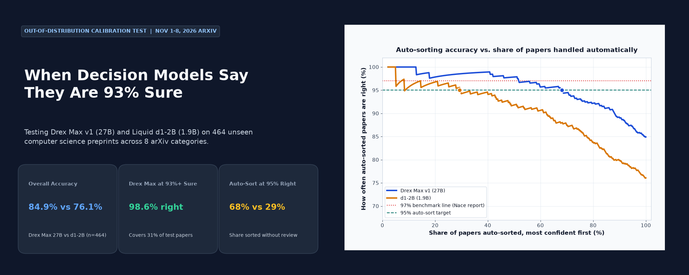

> **Benchmark claim tested**: *"When Drex Max is at least 93% sure, it is right 97% of the time."* — [Nace AI, Nov 6, 2026 report](https://www.nace.ai/research/towards-foundation-decision-models) (`arXiv:2611.07854`)

Two open-weight non-generative decision models — **[Drex Max v1](https://huggingface.co/nace-ai/drex-max-v1)** (Nace AI, 27B) and **[d1-2B](https://huggingface.co/LiquidAI/d1-2B)** (Liquid AI, 1.9B) — output direct choice probability distributions in a single forward pass instead of generating tokens. Alongside [Artificial Analysis Decision Index v2](https://x.com/ArtificialAnlys/status/2119578471559213411) introducing calibration scoring and Nace announcing open weights for [Drex Max v1.1 "soon"](https://x.com/NaceAI/status/2119792132558819447), we test the **open weights available today (Drex Max v1 and d1-2B)** across two controlled evaluations:

- **Part 1 — Zero-Contamination arXiv Calibration (`n = 560`)**: **arXiv CS papers submitted Nov 1–8, 2026** routed into **8 categories** from **title + abstract alone** (`96` stratified fit + `464` frozen test).
- **Part 2 — Model Selection & LLM Cost-Quality Routing (`n = 600` + Part 1 Cascade)**: Zero-shot binary LLM routing on **[`SPROUT-o3mini`](https://huggingface.co/datasets/CARROT-LLM-Routing/SPROUT-o3mini)** (`Llama-3.2-3B` vs. `OpenAI o3-mini`, `100` fit + `500` test), testing Nace's threshold non-transferability (`arXiv:2611.07854` §M), plus a **local-to-GPU cascade** (`d1-2B` on Apple M3 $\to$ `Drex Max v1` on A100) on the unseen arXiv test split.

---

## Key Takeaways (`n = 464` Unseen Test Papers)

1. **The `>=93% -> 97%` rule holds out of the box for Drex Max v1 — even slightly better than advertised.**
   Drex Max v1 clears `>= 0.93` on **33.6%** (`156/464`) of test papers by raw top probability (`p_top`) and hits **98.7%** `[96.7%, 100.0%]` accuracy (`154/156`). Under Drex's stricter chance-adjusted `answer()` score (`chance_corrected >= 0.93`, equivalent to `p_top >= 0.93875`), it clears **31.0%** (`144/464`) at **98.6%** `[96.5%, 100.0%]` accuracy (`142/144`). The only **2 misses above 93%** (`2611.02152` on backpropagation derivation filed under `cs.CL`, and `2611.08108` on post-quantum Ethereum signatures filed under `cs.DC`) are author-filing quirks that d1-2B also missed.
2. **Drex Max v1 routes 68% of papers cleanly at 95% accuracy; d1-2B manages 29%.**
   Ranking predictions from highest to lowest confidence, Drex Max v1 auto-sorts **68.1%** (`316/464`, 95% CI `[50.9%, 78.2%]`) of test papers while maintaining `>= 95.0%` primary accuracy (`p_top >= 0.715`), compared to **29.3%** (`136/464`, `[4.7%, 51.9%]`) for d1-2B (`p_top >= 0.757`). Including valid author cross-listed tags raises Drex's auto-sort accuracy even higher (`88.1%` overall vs. `84.9%` primary).
3. **Out-of-the-box d1-2B is heavily underconfident — not overconfident — and a 96-label scalar fix nearly eliminates its calibration gap.**
   Out of the box, d1-2B leaves most correct predictions in the `60–85%` confidence band (15-bin ECE **11.7%** vs. Drex's **5.6%**), so only **4.5%** (`21/464`) reach `p_top >= 0.93` (where `21/21 = 100.0%` are right, exact Clopper-Pearson `[83.9%, 100.0%]`). Fitting a single scalar temperature multiplier on **96 labeled examples (12/category)** (`τ = 0.701`) slashes d1-2B's ECE nearly **3x** (`11.7% -> 4.3%`) and **4.1x expands** `p_top >= 0.93` coverage (`4.5% -> 18.8%`, `87/464`) at **96.6%** accuracy `[92.1%, 100.0%]`. On Drex Max v1 (`τ = 0.916`), ECE drops from **5.6% -> 4.0%** and `p_top >= 0.93` coverage increases from **33.6% -> 37.7%** (`175/464`) at **98.9%** accuracy (`173/175`).
4. **Confidence breaks gracefully at real category overlaps and never flips above 93% on Drex.**
   Reversing the order of all 8 option choices flips **0 / 156 (0.0%)** Drex predictions at `p_top >= 0.93` and **3.9%** (`18/464`) overall (all 18 had `p_top < 0.60`, mean `45.9%`). Accuracy is highest on sharp domains (`cs.CV`: `98.3%`, `cs.RO`: `91.4%`, `cs.CL`: `91.4%`) and weakest on **`cs.SE` (`70.7%` Drex / `63.8%` d1)** and **`cs.DC` (`74.1%` Drex / `50.0%` d1)** where LLM-agent and distributed-ML papers blend into `cs.CL` and `cs.LG`. On cross-listed papers (`n = 63`), Drex's primary match drops from `86.5%` to `74.6%`, yet its **any-listed accuracy is `98.4%`** (`62/63`) and its `>=93%` rate drops by half (`36.2% -> 17.5%`).

---

## Important Note: The Two "Confidence" Definitions

Drex Max and d1-2B compute `confidence` differently in their reference Python wrappers:

- **Raw top probability (`p_top`)** — returned directly by **`LiquidAI/d1-2B`** (`SystemOneModel.system_one_batch()` in the HuggingFace repo):
  $$\text{confidence}_{\text{raw}} = p_{\text{top}} = \max_{k \in \{1,\dots,8\}} p_k$$
- **Chance-corrected confidence (`chance_corrected`)** — returned by **`answer()` in [`nace-ai/drex-max-v1/code/drex_max/model.py`](https://huggingface.co/nace-ai/drex-max-v1/blob/main/code/drex_max/model.py)**:
  $$\text{confidence}_{\text{cc}} = \frac{p_{\text{top}} - \frac{1}{K}}{1 - \frac{1}{K}} = \frac{p_{\text{top}} - 0.125}{0.875} \quad (K = 8)$$

Clearing `chance_corrected >= 0.93` requires a stricter raw top probability of **`p_top >= 0.93875`** (`93.88%`). To ensure an apples-to-apples comparison, **all evaluations below report both definitions side-by-side** (using `p_top` as the primary probability metric for Expected Calibration Error against empirical accuracy). Both checkpoints are evaluated using their native non-generative decision APIs and served checkpoint temperatures (`1.0087` on Drex Max v1; `1.3374` on d1-2B).

---

## Headline Results (`n = 464` Test Split)

All metrics are computed strictly on the held-out **test split (`n = 464`, 58 per category)** with **2,000 percentile bootstrap resamples (`seed = 0`)** for 95% confidence intervals (and exact Clopper-Pearson binomial intervals when accuracy is `100%`).

### 1. Classification Accuracy & Throughput

| Model | Primary Accuracy | Macro-F1 | Any-Listed Accuracy (incl. cross-lists) | Inference Speed & Hardware |
|---|---|---|---|---|
| **Drex Max v1 (27B)** | **84.9%** `[81.5%, 87.9%]` (`394/464`) | **85.2%** `[81.8%, 88.0%]` | **88.1%** `[84.9%, 90.9%]` (`409/464`) | `5.38 papers/s` `[5.33, 5.42]` (`A100-SXM4-80GB`, `bf16`, `batch=8`) |
| **d1-2B (1.9B)** | **76.1%** `[72.2%, 79.7%]` (`353/464`) | **76.3%** `[72.4%, 79.8%]` | **79.3%** `[75.6%, 83.0%]` (`368/464`) | `0.82 papers/s` `[0.81, 0.83]` (`Apple M3 MPS`, `bf16`, `batch=16`) |

### 2. Testing the `>=93% Sure -> 97% Right` Claim

| Model | Regime | Confidence Rule | Share Clearing `>=0.93` | Accuracy at `>=0.93` (Primary) | Accuracy at `>=0.93` (Any Listed) |
|---|---|---|---|---|---|
| **Drex Max v1 (27B)** | Out-of-the-box | `p_top >= 0.93` | **33.6%** `[29.3%, 37.7%]` (`156/464`) | **98.7%** `[96.7%, 100.0%]` (`154/156`) | **98.7%** (`154/156`) |
| **Drex Max v1 (27B)** | Out-of-the-box | `chance_corrected >= 0.93` (`p_top >= 0.939`) | **31.0%** `[26.7%, 35.1%]` (`144/464`) | **98.6%** `[96.5%, 100.0%]` (`142/144`) | **98.6%** (`142/144`) |
| **Drex Max v1 (27B)** | After 96-label fix | `p_top >= 0.93` | **37.7%** `[33.4%, 42.0%]` (`175/464`) | **98.9%** `[97.0%, 100.0%]` (`173/175`) | **98.9%** (`173/175`) |
| **Drex Max v1 (27B)** | After 96-label fix | `chance_corrected >= 0.93` | **36.2%** `[31.9%, 40.5%]` (`168/464`) | **98.8%** `[96.9%, 100.0%]` (`166/168`) | **98.8%** (`166/168`) |
| **d1-2B (1.9B)** | Out-of-the-box | `p_top >= 0.93` | **4.5%** `[2.8%, 6.5%]` (`21/464`) | **100.0%** (`21/21`, CP `[83.9%, 100.0%]`) | **100.0%** (`21/21`) |
| **d1-2B (1.9B)** | Out-of-the-box | `chance_corrected >= 0.93` | **3.4%** `[1.9%, 5.2%]` (`16/464`) | **100.0%** (`16/16`, CP `[79.4%, 100.0%]`) | **100.0%** (`16/16`) |
| **d1-2B (1.9B)** | After 96-label fix | `p_top >= 0.93` | **18.8%** `[15.5%, 22.4%]` (`87/464`) | **96.6%** `[92.1%, 100.0%]` (`84/87`) | **96.6%** (`84/87`) |
| **d1-2B (1.9B)** | After 96-label fix | `chance_corrected >= 0.93` | **16.8%** `[13.6%, 20.3%]` (`78/464`) | **96.2%** `[91.4%, 100.0%]` (`75/78`) | **96.2%** (`75/78`) |

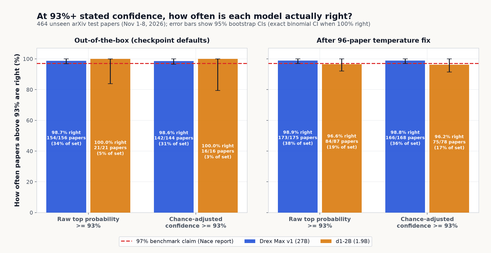

### 3. Effect of the 96-Label Temperature Fix

One scalar logit multiplier $\tau$ per model is fitted by minimizing NLL on the disjoint **fit split (`n = 96`, 12 papers per category)** (`probabilities ** (1 / tau)` renormalized, equivalent to scaling log-probabilities before softmax). Both models had $\tau < 1.0$, meaning both were **underconfident** on unseen arXiv abstracts out of the box (Drex mildly so; d1-2B strongly so):

| Model | Fitted $\tau$ (`n = 96`) | 15-Bin ECE (`p_top`) Before -> After | Test NLL Before -> After | `chance_corrected` Gap Before -> After |
|---|---|---|---|---|
| **Drex Max v1 (27B)** | **0.916** `[0.651, 1.155]` | **5.6%** `[4.7%, 9.3%]` -> **4.0%** `[3.4%, 7.8%]` | `0.451` `[0.384, 0.526]` -> `0.447` `[0.375, 0.527]` | `8.4%` `[6.5%, 11.6%]` -> `6.4%` `[5.2%, 9.9%]` |
| **d1-2B (1.9B)** | **0.701** `[0.530, 0.854]` | **11.7%** `[9.6%, 15.5%]` -> **4.3%** `[3.8%, 8.9%]` | `0.685` `[0.628, 0.748]` -> `0.629` `[0.552, 0.714]` | `16.1%` `[13.4%, 19.9%]` -> `5.5%` `[5.0%, 10.3%]` |

| Drex Max v1 Reliability | d1-2B Reliability |
|---|---|
| 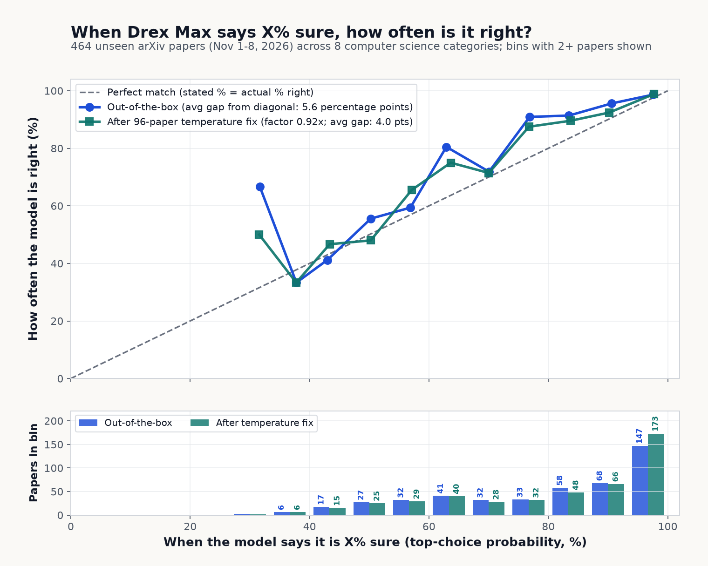 | 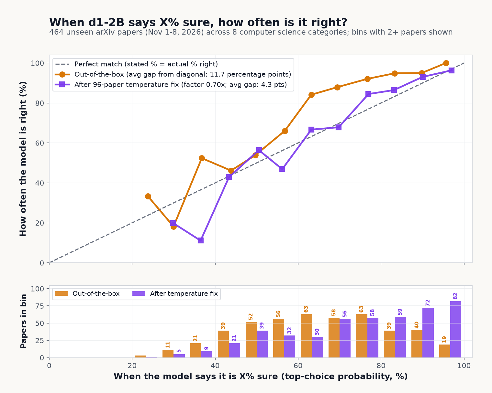 |

---

## Where Confidence Holds and Where It Breaks

### Coverage vs. Precision (Auto-Routing Without Human Review)

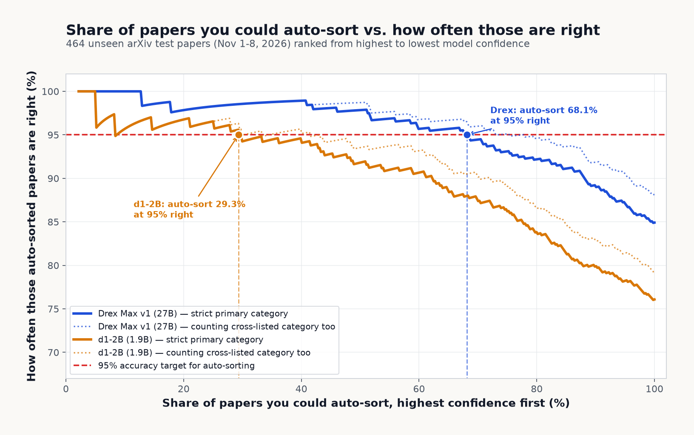

Even after temperature scaling aligns d1-2B's probabilities with actual accuracy (`ECE = 4.3%`), **ranking discrimination remains much stronger in the 27B model**:
- **Drex Max v1 (27B)** safely auto-sorts **68.1%** (`316/464`, `[50.9%, 78.2%]`) at `>= 95.0%` primary accuracy (`p_top >= 0.715` out of the box; `0.747` after temp fix).
- **d1-2B (1.9B)** safely auto-sorts **29.3%** (`136/464`, `[4.7%, 51.9%]`) at `>= 95.0%` primary accuracy (`p_top >= 0.757` out of the box; `0.859` after temp fix).

### Out-of-the-Box Confidence Bands (`n = 464`)

| `p_top` Band | Drex Max v1 Count | Drex Primary / Any-Listed Acc. | d1-2B Count | d1 Primary / Any-Listed Acc. |
|---|---|---|---|---|
| `[0.93, 1.00]` | `156 (33.6%)` | **98.7% / 98.7%** (`mean 97.3%`) | `21 (4.5%)` | **100.0% / 100.0%** (`mean 95.4%`) |
| `[0.85, 0.93)` | `76 (16.4%)` | **96.1% / 98.7%** (`mean 89.2%`) | `48 (10.3%)` | **93.8% / 93.8%** (`mean 88.8%`) |
| `[0.80, 0.85)` | `41 (8.8%)` | `87.8% / 87.8%` (`mean 82.5%`) | `29 (6.2%)` | `96.6% / 96.6%` (`mean 82.4%`) |
| `[0.70, 0.80)` | `51 (11.0%)` | `84.3% / 90.2%` (`mean 75.0%`) | `86 (18.5%)` | **93.0% / 95.3%** (`mean 75.3%`) |
| `[0.60, 0.70)` | `55 (11.9%)` | `78.2% / 85.5%` (`mean 64.2%`) | `98 (21.1%)` | **83.7% / 88.8%** (`mean 64.9%`) |
| `[0.00, 0.60)` | `85 (18.3%)` | `52.9% / 60.0%` (`mean 49.8%`) | `182 (39.2%)` | `53.3% / 57.7%` (`mean 47.5%`) |

### Option-Order Reversal & Cross-List Ambiguity (`n = 464`)

1. **Option-order reversal is confined to uncertain papers**:
   Reversing the order of all 8 option descriptions flipped **3.9%** `[2.2%, 5.6%]` (`18/464`) of Drex Max v1 predictions (reversed accuracy `86.0%` `[82.8%, 89.0%]`) and **7.1%** `[4.7%, 9.5%]` (`33/464`) of d1-2B predictions (reversed accuracy `75.4%`). Crucially:
   - **Drex Max v1 (`>=0.93` / `0.60–0.93` / `<0.60`) flip rates**: **`0/156 (0.0%)`** / **`0/223 (0.0%)`** / **`18/85 (21.2%)`** (`mean p_top` on flipped papers `45.9%` vs. `80.9%` on steady papers).
   - **d1-2B (`>=0.93` / `0.60–0.93` / `<0.60`) flip rates**: **`0/21 (0.0%)`** / **`1/261 (0.4%)`** / **`32/182 (17.6%)`** (`mean p_top` on flipped papers `42.9%` vs. `66.7%` steady).
2. **Low confidence tracks genuine multi-category ambiguity**:
   On the **63 test papers** whose authors listed a secondary category inside our 8-label set (`n = 63` vs. `n = 401` single-set):
   - **Drex Max v1** primary accuracy drops from `86.5%` (`[83.1%, 89.7%]`) to `74.6%` (`[63.9%, 84.8%]`), yet **any-listed category accuracy hits `98.4%`** (`[94.6%, 100.0%]`, `62/63`) while its mean confidence drops (`80.5% -> 74.0%`) and `p_top >= 0.93` rate halves (`36.2% -> 17.5%`).
   - **d1-2B** shows the exact same pattern: primary drops `76.8% -> 71.4%`, **any-listed accuracy hits `95.2%`** (`60/63`), and `p_top >= 0.93` drops from `5.2% -> 0.0%` (`0/63`).

### Where Category Boundaries Break (`cs.SE` and `cs.DC` vs. `cs.CL` / `cs.LG`)

| Drex Max v1 Confusion Matrix | d1-2B Confusion Matrix |
|---|---|
| 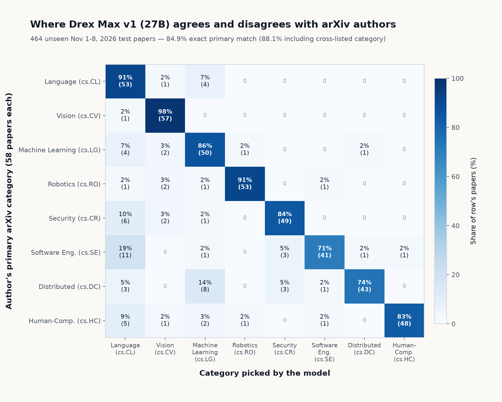 | 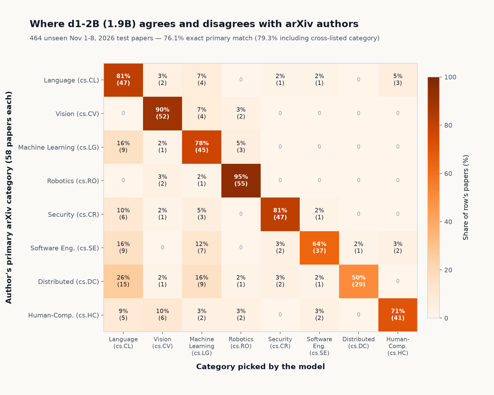 |

Per-category primary recall (`n = 58` test papers each) reveals clear attractors:
- **Sharpest domains**: `cs.CV` (**98.3%** Drex / `89.7%` d1), `cs.RO` (**91.4%** Drex / **94.8%** d1), `cs.CL` (**91.4%** Drex / `81.0%` d1), `cs.LG` (**86.2%** Drex / `77.6%` d1), `cs.CR` (**84.5%** Drex / `81.0%` d1), `cs.HC` (**82.8%** Drex / `70.7%` d1).
- **Weakest domains**: **`cs.SE`** (**70.7%** Drex / `63.8%` d1) and **`cs.DC`** (**74.1%** Drex / `50.0%` d1). Both models over-predict `cs.CL` (`84` Drex / `91` d1 vs. `58` true) and `cs.LG` (`67` Drex / `75` d1) when routing LLM-for-software-engineering, multi-agent systems, distributed training, or cryptographic blockchain papers (`19%` of `cs.SE` goes to `cs.CL` on Drex; `26%` of `cs.DC` goes to `cs.CL` and `16%` to `cs.LG` on d1-2B).

---

## Methodology, Scope & Limitations

- **Unseen dataset (`Nov 1–8, 2026`)**: Pulled directly via `export.arxiv.org/api/query` across 8 CS categories (`cs.CL, cs.CV, cs.LG, cs.RO, cs.CR, cs.SE, cs.DC, cs.HC`), filtered to papers with `<= 1` cross-list (`11.81%` in-set cross-list rate overall across `2,142` eligible submissions, chosen over Set A containing `cs.AI` which had `27.92%` overlap). Stratified `seed = 0` sample of `70/category` (`560` total -> `96` fit + `464` test). Both models were released earlier and could not have trained on these abstracts.
- **Noisy author labels**: Gold labels reflect submitting authors' primary filing choice rather than an objective committee label—explaining why cross-listed papers have `98.4%` any-listed accuracy on Drex and why the only two Drex errors above 93% (`2611.02152` on backpropagation and `2611.08108` on post-quantum Ethereum signatures) are misfiled/dual-domain submissions.
- **Two-task scope & Nace benchmark comparison**: Part 1 evaluates 8-way CS abstract classification (`n = 464`); Part 2 adds zero-shot binary LLM cost-quality routing (`n = 500`). Neither model was fine-tuned on `SPROUT-o3mini`'s model-pair error boundaries, so differences vs. Nace's 37-task Decision Index report reflect domain/task shift and zero-shot meta-reasoning difficulty.
- **Model versions tested**: Tests open **Drex Max v1** (`nace-ai/drex-max-v1`, commit `81cb1111d9ceb6fb54eb2e300890ec5380f175c0`) and **d1-2B** (`LiquidAI/d1-2B`, commit `652f920e544ea37f81e4b0ce89b81d4ed0da90b1`), not Nace's announced upcoming v1.1.

---

## Part 2: Model Selection & Zero-Shot LLM Cost-Quality Routing

Using the exact same open weights, we test **two practical model-selection scenarios**: (A) zero-shot **LLM prompt routing** between a tiny model and a frontier reasoning model on [`CARROT-LLM-Routing/SPROUT-o3mini`](https://huggingface.co/datasets/CARROT-LLM-Routing/SPROUT-o3mini) (`n = 600`: `100` fit + `500` held-out test), and (B) a **decision-model cascade** (`d1-2B` local Apple M3 $\to$ `Drex Max v1` A100 GPU) on Part 1's `464` unseen Nov 2026 arXiv papers.

### A. Zero-Shot LLM Router (`Llama-3.2-3B` vs. `OpenAI o3-mini`, `n = 500` Test Split)

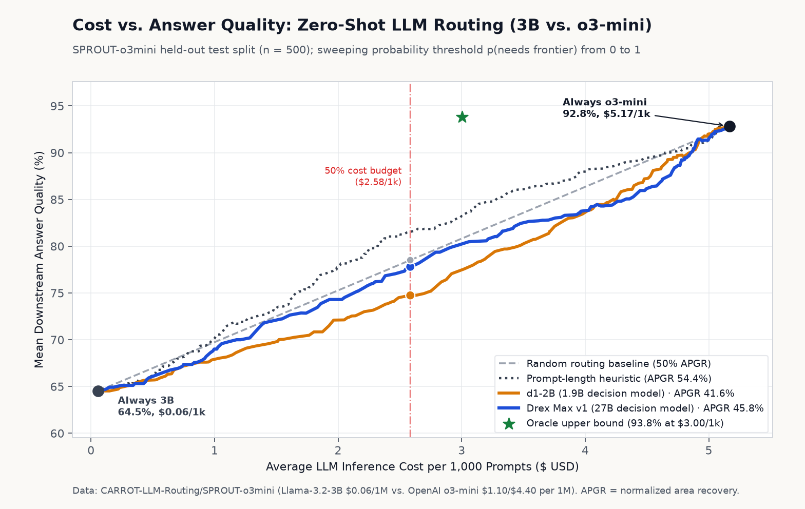

Each prompt is evaluated zero-shot as a binary decision between `"small"` (`Llama-3.2-3B-Instruct`, `$0.06/1M`) and `"frontier"` (`OpenAI o3-mini`, `$1.10/$4.40 per 1M`), scored using SPROUT's exact per-query correctness and stored input/output token costs (2,000-resample 95% bootstrap CIs, `seed = 0`):

| Router / Policy | Quality | Cost per 1k Prompts | Cost Savings vs. Frontier | AUROC / Binary Acc (`@0.50`) | APGR (`PGR @ 50% Cost`) |
|---|---|---|---|---|---|
| **Always Small (`Llama-3.2-3B`)** | `64.5%` `[60.6%, 68.5%]` | **`$0.06`** (`$0.057`) | `98.9%` | `—` / `50.8%` | `0.0%` (`0.0%`) |
| **Always Frontier (`o3-mini`)** | `92.8%` `[90.7%, 94.7%]` | **`$5.17`** (`$5.168`) | `0.0%` | `—` / `49.2%` | `100.0%` (`100.0%`) |
| **Oracle Upper Bound** | `93.8%` `[91.9%, 95.6%]` | **`$3.00`** (`$3.001`) | `41.9%` | `—` / `100.0%` | `103.5%` |
| **Prompt-Length Heuristic** *(longest first)* | `—` | *sweep* | *sweep* | `0.520` `[0.469, 0.570]` | **`54.4%`** `[50.0%, 58.6%]` |
| **Drex Max v1 (27B, zero-shot)** | `85.1%` (`@0.50`) | `$4.33/1k` (`@0.50`) | `16.2%` (`@0.50`) | **`0.583`** `[0.533, 0.632]` / `55.0%` | **`45.8%`** `[41.6%, 50.4%]` (`46.9%`) |
| **d1-2B (1.9B, zero-shot)** | `79.7%` (`@0.50`) | `$3.34/1k` (`@0.50`) | `35.3%` (`@0.50`) | **`0.615`** `[0.565, 0.662]` / `59.4%` | **`41.6%`** `[37.7%, 46.1%]` (`36.1%`) |

Four key empirical findings emerge on SPROUT-o3mini:

1. **Binary ranking (`AUROC`) diverges sharply from economic routing (`APGR`)**:
   - **d1-2B edges Drex Max v1 on raw binary AUROC** (`0.615` vs. `0.583`, $\Delta = -0.032$ `[-0.065, +0.000]`), yet **Drex Max v1 beats d1-2B on cost-quality APGR** (`45.8%` vs. `41.6%`, $\Delta = +4.2\text{ pt}$ `[+1.4, +7.0]`; `46.9%` vs. `36.1%` PGR at 50% cost).
   - **Why both trail a dumb prompt-length heuristic (`54.4%` APGR vs. `50%` random chord)**: On SPROUT-o3mini, short open-ended `openhermes` prompts (`250` chars mean) trigger verbose, expensive `o3-mini` reasoning (`$5.52/1k`) for only `+18.0 pt` quality gain, whereas longer `MMLU-Pro` prompts (`766` chars) cost **less** (`$4.91/1k`) and deliver **`+43.2 pt`** marginal gain (`3B = 43.2%`, `o3-mini = 86.4%`). Zero-shot decision models predict *perceived math hardness* first (`MATH` receives **`83.8%`** mean `p(frontier)` on Drex and `53.4%` on d1, even though `Llama-3.2-3B` already solves `67.7%` of `MATH`), whereas length accidentally front-loads high-ROI `MMLU-Pro`. Drex partially recovers on `APGR` because it routes `MMLU-Pro` (`57.5%` mean `pfr`) much more aggressively than d1 (`39.7%`).
   - Evaluating the exact same prompt probabilities across **secondary LLM pairs (`n = 500`)**: `GPT-4o-mini -> o3-mini` reaches **AUROC `0.620` / APGR `52.3%` / PGR@50% `54.6%`** on Drex (`0.609` / `47.6%` / `39.5%` on d1); `Llama-3.1-8B -> o3-mini` hits `0.574` / `48.7%` (Drex) and `0.607` / `43.9%` (d1); `Llama-3.2-3B -> Claude-3.5-Sonnet` hits `0.510` / `41.5%` (Drex) and `0.552` / `39.7%` (d1).

2. **Fixed decision cutoffs fail to transfer across models (confirming Nace `arXiv:2611.07854` §M)**:
   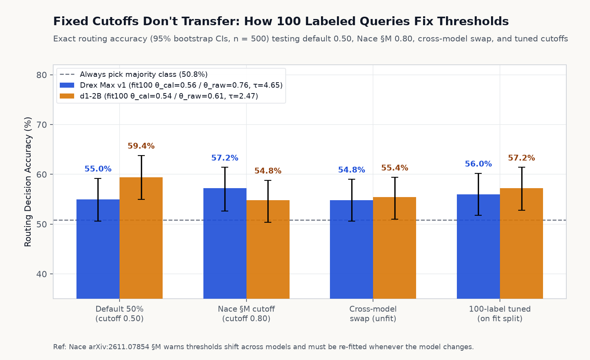
   - At default `0.50`, Drex Max v1 over-escalates **`69.8%`** (`$4.33/1k`, `55.0%` route acc), whereas d1 escalates **`45.0%`** (`$3.34/1k`, `59.4%` acc). Applying Nace §M's `0.80` cutoff shifts Drex to `50.0%` escalation (`57.2%` acc, `$3.54/1k`, `82.6%` qual), **but collapses d1-2B to `14.4%` escalation** (`69.6%` qual, `$1.45/1k`).
   - Fitting cutoff $\theta$ on **`100` labeled fit-split queries** aligns operating points to each checkpoint's scale: Drex tunes to `theta_raw = 0.759` (`54.4%` esc, `56.0%` acc, `$3.70/1k`, or `0.913` for `50%`-budget `$2.54/1k`); d1 tunes to `theta_raw = 0.609` (`32.4%` esc, `57.2%` acc, `$2.69/1k`, or `0.699` for `50%`-budget `$2.28/1k`). Cross-swapping those thresholds again breaks escalation (`61.6%` on Drex vs. `18.2%` on d1).

3. **Calibration flips sign on meta-cognitive routing — both models become severely OVERCONFIDENT**:
   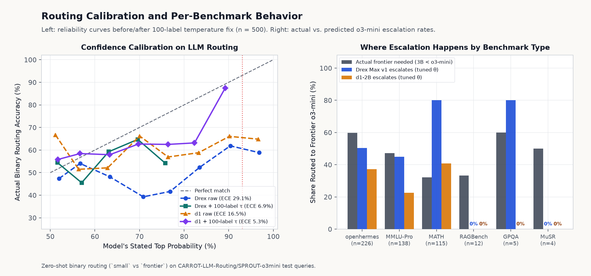
   - Unlike Part 1 (`tau = 0.916` Drex, `0.701` d1 — underconfident on 8-way arXiv topics), predicting another LLM's failure makes **both models heavily overconfident**:
     - **Drex Max v1 (`K = 2`)**: 15-bin `p_top` ECE = **`29.1%`** `[25.6%, 33.8%]` (`NLL = 1.098`, `Brier = 0.339`). At `p_top >= 0.93`, accuracy collapses to **`58.7%`** `[51.3%, 66.1%]` (`98/167`, `33.4%` share); at `chance_corrected >= 0.93` (`p_top >= 0.965`), accuracy is **`61.1%`** `[50.6%, 71.3%]` (`55/90`, `18.0%` share). **100-label temperature scaling (`tau = 4.649`) slashes ECE 4.2x (`29.1% -> 6.9%` `[4.2%, 11.4%]`)**, drops NLL `1.098 -> 0.694`, and suppresses all false `>=0.93` certainty (`0/500`).
     - **d1-2B (`K = 2`)**: raw `p_top` ECE = **`16.5%`** `[13.0%, 21.2%]` (`>=0.93` accuracy **`66.1%`**, `37/56`). **`tau = 2.471` cuts ECE 3.1x (`16.5% -> 5.3%` `[3.3%, 10.0%]`)** and NLL `0.804 -> 0.682` (`0/500` left `>=0.93`).
   - **Per-benchmark breakdown & option reversal**: Reversing `"small"` and `"frontier"` order flips **`3.6%`** `[2.0%, 5.4%]` (`18/500`) of Drex choices vs. **`11.4%`** `[8.8%, 14.2%]` (`57/500`) on d1-2B. Drex escalates `80.0%` of `MATH` (`90.4%` at `@0.50`, only `32.2%` needed) yet **`0.0%`** of `RAGBench` (`n=12`) and `MuSR` (`n=4`).

---

### B. Part 1 Decision-Model Cascade (`d1-2B` Local Apple M3 $\to$ `Drex Max v1` A100 GPU, `n = 464`)

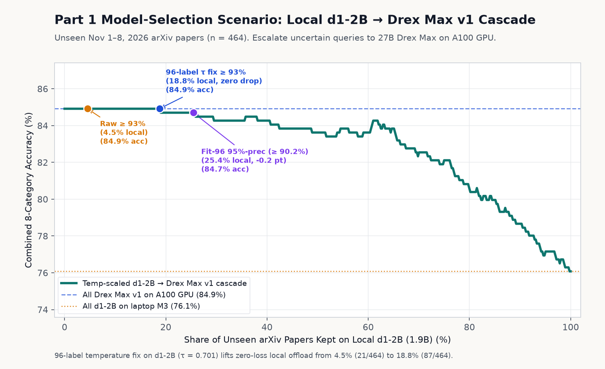

When both models operate in-wheelhouse on unseen Nov 2026 arXiv abstracts (`d1-2B` running locally on Apple M3 at `$0` GPU cost, escalating low-confidence papers to 27B `Drex Max v1` on A100):

| Cascade Policy (`n = 464` Unseen Test Papers) | Kept on Local `d1-2B` | Escalated to `Drex Max v1` | Combined Primary Accuracy |
|---|---|---|---|
| **All `Drex Max v1` (A100 GPU)** | `0.0%` (`0/464`) | `100.0%` (`464/464`) | **`84.9%`** `[81.5%, 87.9%]` |
| **Uncalibrated `d1 >= 0.93`** | `4.5%` (`21/464`, `[2.8%, 6.5%]`) | `95.5%` (`443/464`) | **`84.9%`** `[81.5%, 87.9%]` (**0.0 pt drop**) |
| **96-label $\tau = 0.701$: `d1_temp >= 0.93`** | **`18.8%`** (`87/464`, `[15.5%, 22.4%]`) | `81.2%` (`377/464`) | **`84.9%`** `[81.5%, 87.9%]` (**0.0 pt drop — 4.1x free offload**) |
| **96-label fit `95%`-prec (`d1_temp >= 0.902`)** | **`25.4%`** (`118/464`, `[21.8%, 29.7%]`) | `74.6%` (`346/464`) | **`84.7%`** `[81.2%, 87.7%]` (`-0.2 pt`) |
| **All `d1-2B` (Apple M3 Laptop)** | `100.0%` (`464/464`) | `0.0%` (`0/464`) | **`76.1%`** `[72.2%, 79.7%]` |

Because `d1-2B` already gets `>=93%` calibrated predictions right (`96.6%`) at strong margins, **a 96-label scalar temperature fix lets `d1-2B` absorb `18.8%` (`4.1x` more queries) locally with literally zero accuracy loss** (and `25.4%` at `-0.2 pt`) vs. running all `464` abstracts on a 27B A100 GPU.

---

## Reproducing Everything

### Repository Layout

- **Part 1 (Unseen Nov 2026 arXiv Calibration)**:
  - [`scripts/build_dataset.py`](scripts/build_dataset.py) — arXiv API harvest (`data/raw/*.xml`), overlap check (`data/counts.json`), stratified fit/test split (`data/papers.jsonl`).
  - [`scripts/common.py`](scripts/common.py) — Canonical & reversed 8-category prompts and shared output validation.
  - [`scripts/run_d1.py`](scripts/run_d1.py) & [`scripts/run_drex.py`](scripts/run_drex.py) — Inference (`results/d1_*.json[l]`, `results/drex_*.json[l]`).
  - [`scripts/analyze.py`](scripts/analyze.py) & [`scripts/make_charts.py`](scripts/make_charts.py) — Part 1 metrics (`results/metrics.json`, `results/summary.md`) and 7 PNGs under [`assets/`](assets/).
- **Part 2 (SPROUT-o3mini LLM Router & Part 1 Cascade)**:
  - [`scripts/build_router_dataset.py`](scripts/build_router_dataset.py) — Stratified `600`-prompt SPROUT-o3mini subset (`100` fit + `500` test in `data/router_queries.jsonl`).
  - [`scripts/router_common.py`](scripts/router_common.py) — Canonical & reversed binary router prompts plus official SPROUT model pricing.
  - [`scripts/run_d1_router.py`](scripts/run_d1_router.py) & [`scripts/run_drex_router.py`](scripts/run_drex_router.py) — Inference (`results/router_d1_*.json[l]`, `results/router_drex_*.json[l]`).
  - [`scripts/analyze_router.py`](scripts/analyze_router.py) & [`scripts/make_router_charts.py`](scripts/make_router_charts.py) — Part 2 router + cascade metrics (`results/router_metrics.json`, `results/router_summary.md`) and 4 PNGs under [`assets/`](assets/).
- [`notebooks/drex_max_colab.ipynb`](notebooks/drex_max_colab.ipynb) — End-to-end Google Colab A100-80GB notebook covering both Part 1 and Part 2 Drex Max v1 runs.
- [`NOTES.md`](NOTES.md) — Chronological lab notebook with exact software versions, timings, smoke checks, and limitations.

### Commands

```bash
# 1. Dataset + analysis environment (CPU)
python3 -m venv .venv
.venv/bin/pip install -r requirements.txt
.venv/bin/python scripts/build_dataset.py --reuse-raw
.venv/bin/python scripts/build_router_dataset.py

# 2. LiquidAI/d1-2B (local Apple Silicon MPS or CUDA)
python3 -m venv .venv-d1
.venv-d1/bin/pip install -r requirements-d1.txt
.venv-d1/bin/python scripts/run_d1.py --mode full
.venv-d1/bin/python scripts/run_d1_router.py --mode full

# 3. nace-ai/drex-max-v1 (Colab A100-80GB / G4 / H100 — see notebooks/drex_max_colab.ipynb)
pip install -r weights/drex-max-v1/requirements.txt
python3 scripts/run_drex.py --weights weights/drex-max-v1 --papers data/papers.jsonl --results-dir results --batch-size 8 --mode full
python3 scripts/run_drex_router.py --weights weights/drex-max-v1 --queries data/router_queries.jsonl --results-dir results --batch-size 8 --mode full

# 4. Compute metrics & regenerate all 11 charts (Part 1 + Part 2)
.venv/bin/python scripts/analyze.py
.venv/bin/python scripts/make_charts.py
.venv/bin/python scripts/analyze_router.py
.venv/bin/python scripts/make_router_charts.py
```

---

## References

- Nace AI — *Towards Foundation Decision Models* (Nov 6, 2026; `arXiv:2611.07854` incl. §M): https://www.nace.ai/research/towards-foundation-decision-models
- Nace AI — *Drex Max v1.1 open weights announcement*: https://x.com/NaceAI/status/2119792132558819447
- Artificial Analysis — *Decision Index v2 calibration scoring*: https://x.com/ArtificialAnlys/status/2119578471559213411
- Open-weight checkpoints tested: [`nace-ai/drex-max-v1`](https://huggingface.co/nace-ai/drex-max-v1) & [`LiquidAI/d1-2B`](https://huggingface.co/LiquidAI/d1-2B)
- LLM routing benchmark: [`CARROT-LLM-Routing/SPROUT-o3mini`](https://huggingface.co/datasets/CARROT-LLM-Routing/SPROUT-o3mini)
